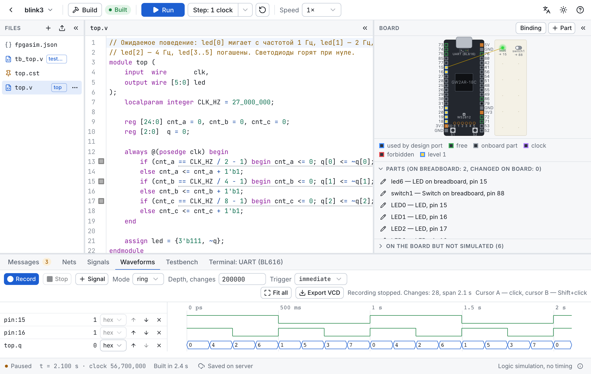
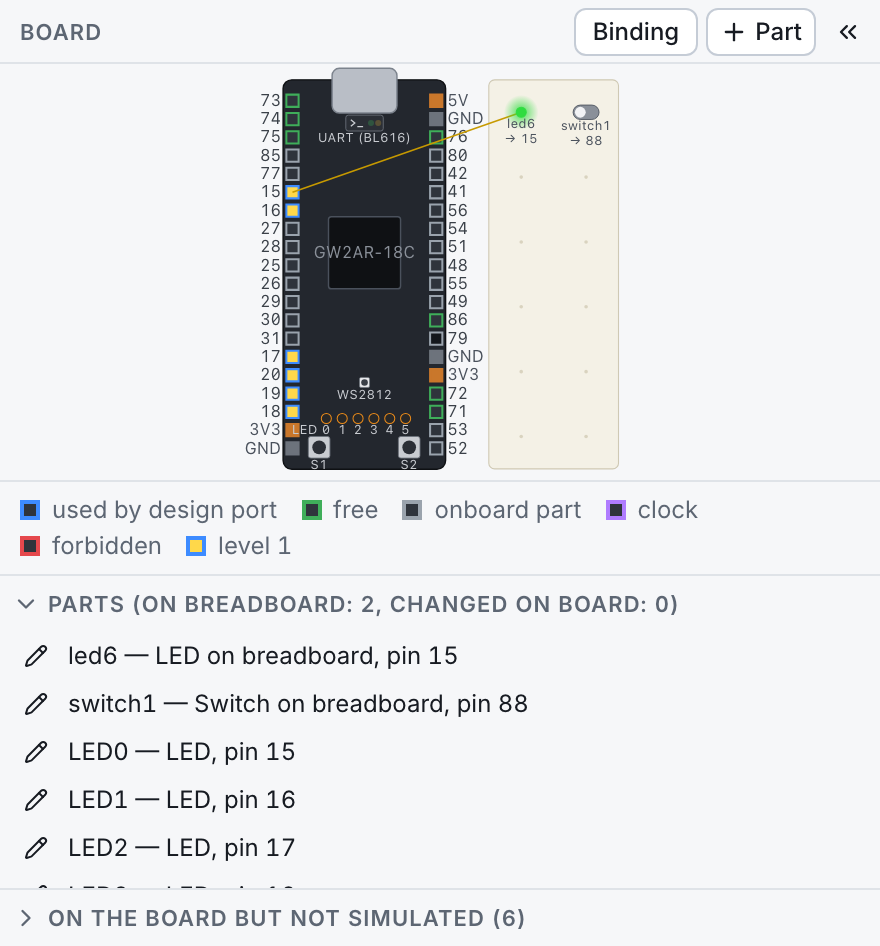

# FPGA SIM

[Русская версия](README.ru.md)

FPGA SIM is a web simulator for Verilog designs on the Sipeed Tang Nano 20K and Tang Nano 9K FPGA
boards. You write or upload Verilog, click "Build", and the design runs in the browser on a drawing of
the real board. You press the board buttons with the mouse, watch the LEDs, read the UART terminal,
and record waveforms. No board and no vendor toolchain are necessary.

The build runs on a server (Verilator compiles the design, Emscripten compiles the result to
WebAssembly). The simulation runs in the browser, in a Web Worker on the user's own processor.



## Why

Students of an FPGA course need a board on the desk to see their design work. Without a board, the
usual tools give a waveform file and nothing else. FPGA SIM shows the same board that the course uses,
with the same pin numbers, so a project from `top.v` and `top.cst` runs without changes. The course
lessons (32 designs, lessons 2 to 10) are the acceptance tests of the simulator.

## Features

- **Board and breadboard.** The board drawing has the onboard LEDs, buttons S1 and S2, the UART bridge
  and, on the 20K, the WS2812 LED. On the breadboard, you add parts and connect them to free header pins: LED,
  button (with optional contact bounce), switch, UART, WS2812 strip, probe.
- **Pin binding.** The simulator reads the Gowin `.cst` file (`IO_LOC`, `IO_PORT`, `PULL_MODE`).
  Without a `.cst` file, you connect ports to pins in the "Binding" dialog and export the result as
  `.cst`.
- **Automatic project setup.** The simulator finds the top module, the clock input and the testbenches
  by itself. The file `fpgasim.json` is optional.
- **Real-time simulation.** The board clock is 27 MHz. The course lessons run at or near real time in a
  desktop browser (1.7× to 2.9× in headless Chromium on an Apple M2 Max; see `docs/v1-report.md`). The
  toolbar shows the actual ratio. You can pause, step by clocks or by time,
  and step until an output changes. PWM output shows as LED brightness.
- **Messages.** Build errors and Verilator warnings go to the "Messages" tab. A click on a message
  moves the editor to the line. Common warnings have a plain-language explanation.
- **Signals and waveforms.** The signal tree shows ports and, on request, internal signals. The watch
  list shows live values. The waveform panel records chosen signals, with a trigger on an edge or a
  change, two cursors, and export to VCD (GTKWave and Surfer open it).
- **UART terminal.** The terminal shows bytes from the design and sends typed text to the design. The
  simulator reports a baud rate mismatch and framing errors.
- **Testbench.** A `tb_*.v` file runs on the server in Icarus Verilog. The tab shows the output and
  opens the testbench VCD file.
- **Projects.** A project is kept in the browser and saved to the server under the user's account, so
  it is available on another computer. A conflict between two computers shows both versions. In Chrome
  and Edge, a project can be a folder on disk: you edit files in your own editor and the simulator
  rebuilds on change. Projects import and export as ZIP archives.
- **Teacher account.** The administrator creates user accounts, resets passwords and opens the
  projects of each user. There is no self-registration.
- **Two languages.** The interface is in English and Russian, with light and dark themes.



## What the simulator does not show

The simulator computes logic, not electronics. The interface states these limits:

- A signal has two states: 0 and 1. There are no X and Z states.
- Registers without an initial value start at zero.
- No delays, setup or hold times.
- No noise or bounce, except bounce enabled in button settings.
- Bidirectional pins do not work.
- A design that works here is not guaranteed to meet timing on the board.

Not supported yet: Gowin primitives (`rPLL` and others), more than one clock, displays, sound, synthesis
check. VHDL is not supported.

## Architecture

```
Browser                                         Build server (VPS)
┌──────────────────────────────┐   sources    ┌──────────────────────────────────┐
│ React interface              │ ───────────▶ │ FastAPI                          │
│   board, editor, waveforms   │              │   container without network:     │
│ Web Worker                   │ ◀─────────── │   Verilator → C++ → Emscripten   │
│   sim.wasm: design + runtime │   sim.wasm   │   Icarus Verilog for testbenches │
│   + part models              │              │   build cache by input hash      │
└──────────────────────────────┘              │ SQLite: accounts and projects    │
                                              └──────────────────────────────────┘
```

- **Core** (`core/`, C++20). The runtime has a time scheduler in picoseconds, models of the parts
  in `parts/` (LED, button, switch, UART, WS2812 strip, probe), signal recording and the message protocol. The runtime is prebuilt; a
  build compiles only the Verilator model of the design and a small generated layer. The simulation
  loop does not allocate memory and does not throw exceptions.
- **Parts** connect only through nets, never call each other. A part is described by a JSON file in
  `parts/`; a board is described by a JSON file in `boards/`. A new board is a new file, not new code.
- **Protocol.** Control messages are JSON; frames and traces are binary. The protocol does not depend
  on the transport: today it is a Web Worker, later the same core can run on a server over a WebSocket.
- **Server** (`server/`, Python 3.12, FastAPI). It builds designs and runs testbenches in a container
  with limits on time, memory and project size, and with no network. User code does not run on the
  server outside that container.
- **Interface** (`web/`, TypeScript, React, Tailwind, shadcn components). The board and the waveforms
  are drawn on Canvas.

Formats (`fpgasim.json`, board file, part file, protocol) have JSON schemas in `spec/`.

## Try it

The application runs at <https://fpga-sim.scriptorium.cc> (English interface:
<https://fpga-sim.scriptorium.cc/?lang=en>). Sign-in requires an account from the administrator.
For access, contact the author.

Hackathon judges get a link with an access key in the testing instructions of the submission. The link
opens the application without sign-in: build, simulation, testbench and all examples work. Projects
stay in that browser only.

## Development

You need Node, `uv` and Docker. Do not install Verilator or Emscripten on the machine: they are in the
build images (`make image`).

| Command | What it does |
|---|---|
| `make dev` | Build server on `localhost:8080` and interface on `localhost:5173`; the development key is in `.fpgasim/dev/key` |
| `make check` | Style, formats and all tests |
| `make test-core` | Core tests (in the container) |
| `make test-server` | Build server tests |
| `make test-examples` | All examples and lessons through a local server, core in Node |
| `make test-web` | Interface tests |
| `make e2e` | End-to-end tests in Chromium against a local stand |
| `make bench` | Speed and build time measurement |

### Self-hosting

The code holds no host names. One deployment is described by a site settings file,
`~/.config/fpgasim/site.env`: copy `deploy/site.env.example` and set the interface address, the build
server address, the SSH host of the VPS, the Cloudflare Pages project and, optionally, the R2 bucket for
the off-site database copy. Then `make deploy-server` deploys the build server (Docker Compose behind
nginx; example vhost in `deploy/nginx-build.conf.example`) and `make deploy-web` deploys the interface to
Cloudflare Pages. The steps are in `docs/deploy-server.md` and `docs/deploy-web.md`.

### Folders

| Folder | Contents |
|---|---|
| `spec/` | Format schemas (project, board, part, protocol), samples in `spec/tests/` |
| `boards/`, `parts/` | Board files and part descriptions |
| `core/` | Runtime and part models, C++20 |
| `server/` | Build server, Python 3.12, and the build image |
| `web/` | Interface |
| `examples/` | Example projects and course lessons with expected behavior in `expect.json` |
| `tools/` | Benchmarks, format checks, native and Node runners, local server |
| `deploy/` | Deployment of the build server to a VPS |
| `e2e/` | End-to-end tests (Playwright) |

## Documents

- `docs/tz-v1.md` — technical specification, the source of truth.
- `docs/tz-accounts.md` — accounts and server-side projects.
- `docs/vision.md` — vision and architecture.
- `docs/decisions.md` — decisions made during development, with dates and reasons.
- `docs/progress.md` — progress log; the first section tells the current state.
- `docs/v1-report.md` — version 1 report: acceptance criteria, build time and speed per lesson.
- `CLAUDE.md`, `AGENTS.md` — rules for coding agents.

## License

MIT, see `LICENSE`. The course lessons in `examples/lessons/` are by the same author and are under
the same license.
